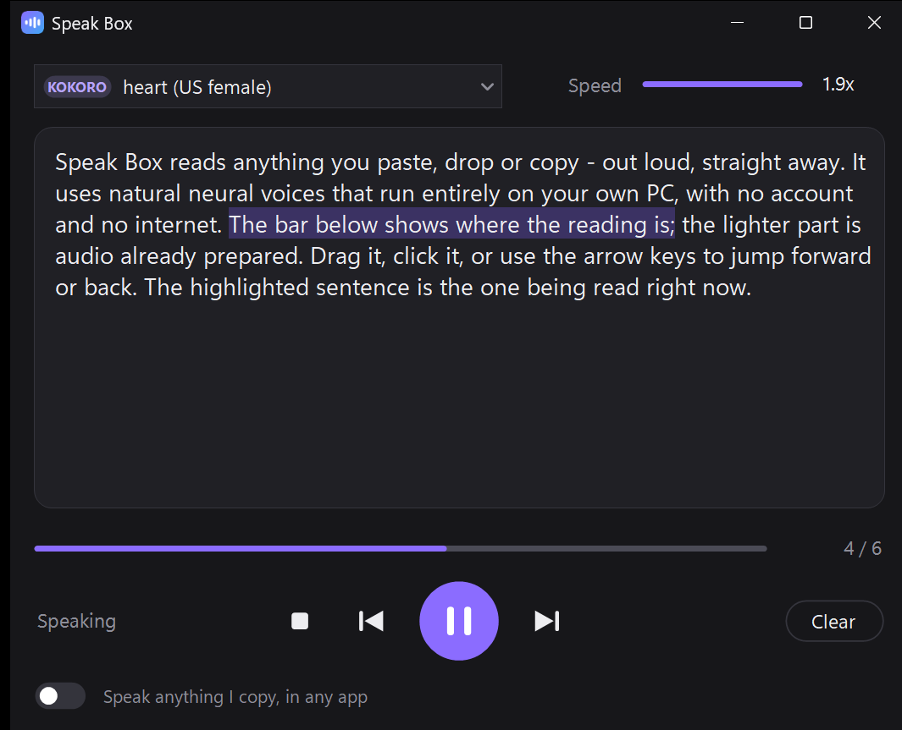
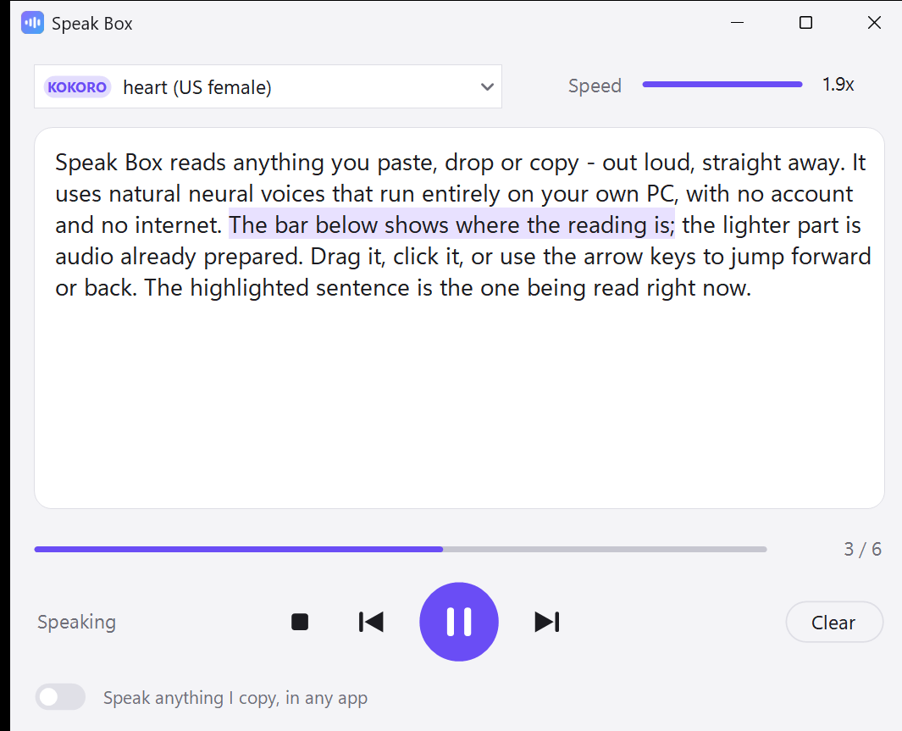
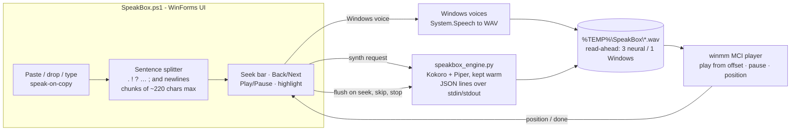

<p align="center">
  
</p>

<h1 align="center">SpeakBox</h1>

<p align="center">
  <b>Offline neural read-aloud for Windows.</b><br>
  Paste, drop or copy text and hear it at once. Your text never leaves your PC.
</p>

<p align="center">
  <a href="https://github.com/BAS-More/speakbox/actions/workflows/ci.yml"></a>
  <a href="LICENSE"></a>
  
  
  
  
</p>

<p align="center">
  
  
</p>

SpeakBox is a small tray app that reads text aloud as soon as you give it some. It reads sentence by sentence and has a real seek bar, and there is no Generate button to press. Speech is made on your own PC by neural voices ([Kokoro](https://huggingface.co/hexgrad/Kokoro-82M) and [Piper](https://github.com/OHF-Voice/piper1-gpl)) or by the voices built into Windows. You don't need an account, an API key or an internet connection.

---

## Features

| | |
|---|---|
| **Speaks as soon as you give it text** | Paste with `Ctrl+V` or `Shift+Insert`, drag in text or a file, or type and press `Enter`. |
| **Speak on copy** | Turn it on and any text you copy in *any* app is read aloud. The copied text is spoken but never written into the box. |
| **A real seek bar** | Drag, click, use the mouse wheel or the arrow keys to move through the text. A shaded band shows audio that is already prepared. |
| **Sentence navigation** | Back / Next buttons, or `Alt+Left` / `Alt+Right`. The sentence being read is highlighted, and a counter shows `n / total`. |
| **Play, pause, resume** | One button does all three. Seeking while paused stays paused. |
| **Three voice engines** | 27 Kokoro voices (US and British English), every Piper voice you install, and every Windows voice on the PC. |
| **Speed control** | About 0.5x to 1.9x on neural voices. If you change speed or voice during a read, it carries on from the same place. |
| **Follows your Windows theme** | Dark or light, including the title bar and scrollbars. You can force one with `-Theme`. |
| **Lives in the tray** | Closing the window hides it. The icon changes while speaking. Only one copy runs at a time. |
| **Works with screen readers** | The custom controls are built on native slider, button, checkbox and combo box controls, so UI Automation and screen readers see real controls. |
| **Fully offline** | All speech is made on your PC. SpeakBox itself makes no network calls. |

---

## Requirements

| | |
|---|---|
| **Windows 11** | Built and tested on Windows 11. Windows 10 is untested: the themed title bar uses DWM attributes that exist only on Windows 11. |
| **[PowerShell 7](https://learn.microsoft.com/powershell/scripting/install/installing-powershell-on-windows)** | Install with `winget install Microsoft.PowerShell`. Tested on 7.6. Windows PowerShell 5.1 will not work. 7.5 or later is probably the minimum (untested). |
| **Python 3.11+** or [uv](https://docs.astral.sh/uv/) | Needed only for the Kokoro and Piper voices; `setup.ps1` installs everything else. Tested with 3.13. The Windows voices work without Python. |
| **An audio output device** | Playback goes through the Windows MCI player. |

You do **not** need to install `espeak-ng` or `ffmpeg` separately. About 1 GB of disk for the default voice set.

---

## Install

### 1. Get the code

```powershell
git clone https://github.com/BAS-More/speakbox.git
cd speakbox
```

No Git? Click **Code > Download ZIP** on this page, unzip it, and open PowerShell 7 in that folder. Put it somewhere you can write to (not `Program Files`), because SpeakBox keeps its settings and logs next to its scripts.

### 2. Run setup (one time, about 1 GB)

```powershell
pwsh -File .\setup.ps1
```

This creates a Python environment in `.venv`, then downloads the Kokoro model and four Piper voices (two UK, two US). Every download is checked against a pinned SHA-256, and files already present are skipped, so it is safe to run again. Uses [uv](https://docs.astral.sh/uv/) if you have it, otherwise Python's own `venv` + `pip`.

| Option | Effect |
|---|---|
| `-AllVoices` | All 9 tested Piper voices |
| `-Voices en_GB-alan-medium,en_US-ryan-high` | Pick your own Piper voices |
| `-NoKokoro` | Skip the Kokoro model (about 350 MB) |
| `-Autostart` | Also start SpeakBox when you sign in (see below) |

Skip this step entirely and SpeakBox still works, with the Windows voices only.

### 3. Start SpeakBox

```powershell
wscript.exe .\Start-SpeakBox.vbs
```

The window opens and an icon appears in the system tray. Paste some text to hear it.

### Start at sign-in (optional)

```powershell
pwsh -File .\tools\install-autostart.ps1          # turn on
pwsh -File .\tools\install-autostart.ps1 -Remove  # turn off
```

This adds a per-user Task Scheduler task (no admin needed) that starts SpeakBox 10 seconds after you sign in. A task is used rather than the Run key or the Startup folder on purpose. Windows starts Run-key entries **one at a time**, and the Startup folder only after all of them, so one hung startup app blocks everything behind it. A task starts on its own.
---

## Using SpeakBox

| Do this | What happens |
|---|---|
| `Ctrl+V` or `Shift+Insert` in the box | Pastes as plain text and starts speaking |
| Drag text or a file onto the window | Speaks it (any dropped file is read as text) |
| Type, then press `Enter` | Speaks the box (`Shift+Enter` adds a new line) |
| `Esc`, or **Stop** | Stops at once |
| **Play** button | Speak, then Pause, then Resume |
| `Alt+Left` / `Alt+Right`, or **< Back** / **Next >** | Previous or next sentence |
| Seek bar: drag, click, mouse wheel or arrow keys | Jumps forward or back in the text |
| Speed slider | Slower or faster. The change applies when you let go. |
| **Clear** | Stops and empties the box |
| **Speak anything I copy, in any app** switch | Reads everything you copy, in any program |

**Tray icon.**
- Double-click the icon to show the window.
- Right-click it for **Show Speak Box**, **Speak clipboard**, **Pause / resume**, **Stop**, **Speak on copy** and **Exit**.
- Closing or minimising the window only hides it to the tray, so speak-on-copy keeps working. A balloon tip tells you this the first time.
- Only **Exit** (or Windows shutting down) quits.
- Starting SpeakBox again brings back the window that is already running.

SpeakBox remembers your voice, speed and speak-on-copy setting.

### Voices

| Engine | Voices | Speed on the test laptop* | Notes |
|---|---|---|---|
| **Kokoro** (neural, fp32 ONNX) | 27 English: 11 US female, 8 US male, 4 British female, 4 British male | Faster than real time (RTF 0.59 to 0.87) | Best quality |
| **Piper** (neural) | Every Piper voice you install | About 6 to 10x faster than real time (RTF 0.10 to 0.18) | Good quality, very fast |
| **Windows** | Every enabled Windows (System.Speech) voice | Not benchmarked | More robotic. Always available, no Python needed |

\* Intel Core Ultra 7 268V, CPU only, under heavy background load. See [Benchmarks](#benchmarks). RTF is generation time divided by audio length, so lower is faster.

Each voice in the list has a coloured **KOKORO**, **PIPER** or **WINDOWS** tag.

<details>
<summary>Kokoro voice names</summary>

- **US female:** heart, bella, nicole, sarah, sky, nova, alloy, aoede, jessica, kore, river
- **US male:** michael, fenrir, puck, adam, echo, eric, liam, onyx
- **British female:** emma, isabella, alice, lily
- **British male:** george, fable, daniel, lewis

The voice pack has 28 English voices. `am_santa` is left out of the app's list.

These Piper voices have been tested with SpeakBox:
- **en_GB:** alan, alba, cori, jenny_dioco, northern_english_male, southern_english_female
- **en_US:** amy, lessac, ryan
</details>

**Speed.** The slider goes from -6 to +6.
- Windows voices use the value directly as the SAPI rate.
- Neural voices use a multiplier: `1 + 0.15*r` above zero and `1 + 0.08*r` below zero. That gives 0.52x to 1.9x.

### Command-line options

`Start-SpeakBox.vbs` runs `pwsh.exe -NoProfile -ExecutionPolicy Bypass -File SpeakBox.ps1` with no console window. You can also run the script yourself:

```powershell
pwsh -NoProfile -File .\SpeakBox.ps1 -Theme dark -Top $false -SpeakOnCopy
```

| Option | Default | Meaning |
|---|---|---|
| `-Theme auto\|dark\|light` | `auto` | `auto` follows the Windows app theme |
| `-Top $true\|$false` | `$true` | Keeps the window on top of other windows |
| `-SpeakOnCopy` | saved setting | Starts with speak-on-copy on (overrides the saved setting) |
| `-MaxChars <n>` | `20000` | Text longer than this is cut off |

---

## How it works

SpeakBox is one PowerShell 7 WinForms script (`SpeakBox.ps1`, with C# helpers compiled through `Add-Type`) and one Python helper process (`speakbox_engine.py`).



1. **Split.** The text (up to `-MaxChars`) is split into sentences on `.`, `!`, `?`, `…`, `;` and line breaks. Closing quotes stay with their sentence. Long sentences are cut into chunks of about 220 characters.
2. **Render ahead.** Each sentence is rendered to its own WAV file. Neural voices prepare 3 sentences ahead and Windows voices 1. That prepared range is the shaded band on the seek bar.
3. **Play.** Each WAV plays through winmm MCI. This is what makes pause and seek possible: MCI can pause, report its position and start from an offset.
4. **Seek or skip.** The seek bar waits 250 ms before acting on a change, and seeks at once on mouse-up. Each new position gets a new *generation* number. A `flush` then tells the engine to drop queued requests from older generations, so you never hear old audio.

### Engine protocol

`speakbox_engine.py` starts on first use and stays running. The neural model is warmed up when the window is first shown. It takes one JSON object per line in each direction:

```text
in   {"cmd":"synth","id":7,"gen":3,"engine":"piper","voice":"en_GB-alan-medium",
      "text":"Hello.","speed":1.2,"out":"C:/.../7.wav"}
in   {"cmd":"flush","gen":4}        drop queued requests older than gen 4
in   {"cmd":"voices"}               (not used by the app)
in   {"cmd":"quit"}

out  {"ready":true}
out  {"id":7,"ok":true,"out":"...","dur":1.93}
out  {"id":7,"ok":false,"error":"..."}
```

Each WAV is written to a `.part` file and then moved into place, so the player never opens a half-written file.

### Other moving parts

- **Single instance.** A named mutex (`Local\SpeakBoxSingleInstance`) stops a second copy from running. A second launch sets the event `Local\SpeakBoxShowWindow`. The running copy checks it every 400 ms and brings itself to the front.
- **Theme.** Read from `HKCU\...\Themes\Personalize\AppsUseLightTheme`. The title bar is themed through DWM window attributes 20, 35 and 36, and the scrollbars use the dark `SetWindowTheme` style.
- **DPI.** The app declares itself system-DPI-aware at start-up and scales every size by `DeviceDpi / 96`, so it is sharp at 125-200% scaling. Mixed-DPI multi-monitor setups have not been tested.

---

## Files SpeakBox writes

Settings and logs live **next to the script**, not in `%APPDATA%`.

| File | Contents |
|---|---|
| `speakbox.state.json` | Engine, voice, speed and speak-on-copy, restored at start |
| `speakbox.log` | App log, including `FATAL` startup errors |
| `speakbox-engine.log` | Python tracebacks from the neural engine |
| `%TEMP%\SpeakBox\*.wav` | Rendered sentences, cleared at start and at exit |

These files, the models and the Python environment are all in `.gitignore`.

---

## Troubleshooting

**It doesn't start at sign-in.** Check the task with `Get-ScheduledTask SpeakBox`, and `speakbox.log`: it records how long PowerShell took to start and when the window appeared.

**The window doesn't appear.**
- It may already be running. Look for the tray icon (it may be under the `^` overflow arrow) and double-click it.
- Otherwise, check `speakbox.log` for a `FATAL` line.
- To see errors in a console, run `pwsh -NoProfile -File .\SpeakBox.ps1` directly.

**Nothing happens when I run `Start-SpeakBox.vbs`.** The launcher calls `pwsh.exe` and shows no error if it is missing. Run `pwsh --version`. If it is not found, install PowerShell 7 with `winget install Microsoft.PowerShell`.

**No Kokoro voices in the list.** Kokoro voices appear only when all three of these files exist. Run `pwsh -File .\setup.ps1` to create them:
- `.venv\Scripts\python.exe`
- `models\kokoro-v1.0.onnx`
- `models\voices-v1.0.bin`

**A Piper voice is missing.** It needs both `voices\piper\<id>.onnx` and `voices\piper\<id>.onnx.json`. `setup.ps1 -Voices <id>` fetches both.

**A neural voice is selected but nothing plays.**
1. Look in `speakbox-engine.log`.
2. Check that the environment imports cleanly: `.\.venv\Scripts\python.exe -c "import piper, kokoro_onnx, numpy"`. If not, run `setup.ps1` again.

**No sound from any voice.** Playback needs a working default audio output device. The component tests check MCI open, play and position on their own, and show which step fails.

**My usual voice is missing.** Windows voices differ from PC to PC. If your saved voice is not there, SpeakBox picks another one from the list.

**Settings don't stick.** Move the folder somewhere writable (not `Program Files`).

**The title bar stays light in dark mode.** Title bar colours need Windows 11.

---

## Windows gotchas: do not undo these

Each of these cost real debugging time.

1. **A hidden launch made the window invisible.** `WScript.Shell.Run(cmd, 0)` passes `SW_HIDE` in the process start-up info. .NET applies it to the first top-level window, which is the form. To fix this, SpeakBox forces itself visible in `Form.Shown`.
2. **A `ShowWindow` call from another process kills the app.** The app dies with no exception and no `FormClosed`. So a second launch only *signals* the running copy, which then calls `SetForegroundWindow` on itself. **There is no raw `ShowWindow` call in the codebase. Do not add one.**
3. **A thread waiting on stdin hangs Python model loading.** On Windows, I/O on one pipe handle runs one operation at a time. The engine reads requests from a duplicated descriptor and points fd 0 at `NUL`.
4. **Painting a `TrackBar` subclass must not read `.Value`.** Doing so syncs the cached value too early, and `ValueChanged` never fires. `SbSlider` reads `TBM_GETPOS` instead.
5. **Custom controls must stay subclasses of native controls.** A plain `Control` subclass shows up to screen readers as an unnamed "Pane". `SbSlider`, `SbButton`, `SbToggle` and `SbCombo` subclass `TrackBar`, `Button`, `CheckBox` and `ComboBox`, and only take over painting.
6. **Copying must never write into the box.** Speak-on-copy only speaks the clipboard text. It leaves the box text alone.
7. **Declare DPI awareness explicitly.** Left to the default, `pwsh.exe` runs DPI-unaware when launched from some parents, and Windows bitmap-stretches the window (blurry, wrong size).
8. **Start at sign-in with a scheduled task at normal priority.** Run-key entries start one at a time, so a hung app earlier in the list blocks the rest. Task Scheduler's default priority (7) runs the app *below normal* for its whole life, so `install-autostart.ps1` sets priority 4.
9. **A killed copy leaves an abandoned mutex.** The next start would die on `AbandonedMutexException`. SpeakBox treats that exception as "you now own the mutex" and carries on.

---

## Tests

```powershell
pwsh -NoProfile -File .\tests\components-speakbox.ps1      # 21 checks, app not running
pwsh -NoProfile -STA -File .\tests\e2e-speakbox.ps1        # 31 checks against the live window
```

**Component tests** (21 checks) cover:
- the script parsing
- the sentence splitter
- an engine round trip with Piper `en_GB-alan-medium` and Kokoro `bf_emma`, including `flush` dropping a stale request
- stopping the engine
- the MCI player states
- Windows voices writing a WAV

They need the Python environment, the Kokoro model and the `en_GB-alan-medium` Piper voice (all installed by `setup.ps1`).

**End-to-end tests** (31 checks) drive the real window through UI Automation. They cover:
- each engine
- seeking
- Back / Next
- pause and resume
- speed changes
- Stop and Clear
- speak-on-copy
- single instance
- a clean `speakbox.log`

The run takes about 2 minutes. It **speaks aloud**, replaces the box text, and uses the clipboard (then restores it).

> **Known limitations.** The e2e suite expects the Windows voice *Hazel*, the Kokoro voice *emma*, the Piper voice *alan* and at least 40 voices in the list (`setup.ps1 -AllVoices`). Treat it as a local regression check on a fully set-up machine, not a CI test. CI runs the parts that need no audio or models.

---

## Benchmarks

[`bench/`](bench/) holds an on-device speech benchmark. **You do not need it to run SpeakBox.** Full method and results are in [bench/RESULTS.md](bench/RESULTS.md).

**Test machine:** Intel Core Ultra 7 268V (Lunar Lake), Arc 140V, AI Boost NPU, 32 GB RAM, Windows 11 Pro, Python 3.13.9. The neural engine choice (Kokoro fp32 + Piper on CPU) came from this study. Each test ran 3 times. The first run was dropped and the median is reported.

| Text to speech (CPU) | RTF short / medium / long |
|---|---|
| Piper `en_US-lessac-medium` | 0.18 / 0.10 / 0.10 |
| Kokoro-82M **fp32** (used by SpeakBox) | 0.87 / 0.59 / not run |
| Kokoro-82M int8 | 1.74 / 1.37 / 1.64 |

On this CPU, int8 Kokoro is about **2x slower** than fp32 because of quantize/dequantize overhead. That is why SpeakBox uses fp32.

The benchmark also covers speech to text and translation, which SpeakBox does not use yet:
- OpenVINO whisper-base: RTF 0.073 (CPU), 0.024 (GPU), 0.019 (NPU)
- Parakeet: RTF 0.17
- OPUS-MT en→de: 95 ms per sentence

> **Caveat:** the machine was under about 97% background CPU load during the runs. The CPU-bound speech-to-text figures are therefore conservative upper bounds. The Piper results and the OpenVINO device comparison were stable regardless.

---

## Extras

The repo includes two separate, optional tools.

- **SpeakSelection** (`Start-SpeakSelection.vbs`) is a tray tool. Select text in any app and press `Ctrl+Alt+R` to hear it. `Ctrl+Alt+S` stops. It uses the Windows voices by default. An optional remote engine works through `Read-Aloud.ps1`.
- **Read-Aloud** (`Read-Aloud.ps1`) is a command-line client. It posts text to an OpenAI-compatible `/v1/audio/speech` endpoint, then saves and plays the audio. **It is not offline.** Set your endpoint in the `NINEROUTER_URL` environment variable.

  ```powershell
  .\Read-Aloud.ps1 -Text "Build is green."
  ```

---

## Contributing

Issues and pull requests are welcome. See [CONTRIBUTING.md](CONTRIBUTING.md) and the [changelog](CHANGELOG.md).

1. Run `tests\components-speakbox.ps1`. If you change the UI, also run the e2e suite on a machine that has the models installed.
2. Read [Windows gotchas](#windows-gotchas-do-not-undo-these) first. Several "simplifications" bring back bugs that have already been fixed.
3. Keep SpeakBox itself offline. Any feature that needs the network belongs with the extras.

---

## License

SpeakBox is licensed under the [Apache License 2.0](LICENSE).

The models and Python packages are **not** part of this repository. They are separate downloads under their own licences:

| Component | Licence |
|---|---|
| [Piper](https://github.com/OHF-Voice/piper1-gpl) (`piper-tts`) and `phonemizer` | GPL-3.0 |
| espeak-ng (pulled in via `espeakng-loader`) | GPL-3.0 |
| [kokoro-onnx](https://github.com/thewh1teagle/kokoro-onnx), [ONNX Runtime](https://github.com/microsoft/onnxruntime) | MIT |
| [Kokoro-82M](https://huggingface.co/hexgrad/Kokoro-82M) model | Apache-2.0 |
| [Piper voices](https://huggingface.co/rhasspy/piper-voices) | Per voice: see each voice's model card |

SpeakBox runs these as a separate Python process and does not bundle them. The GPL-3.0 parts apply if you **redistribute** a bundle that includes the Python environment. This is true even for a Kokoro-only bundle, which still carries `phonemizer` and espeak-ng. Check each licence before you redistribute.

---

Owner's development notes and history: [docs/NOTES.md](docs/NOTES.md).
